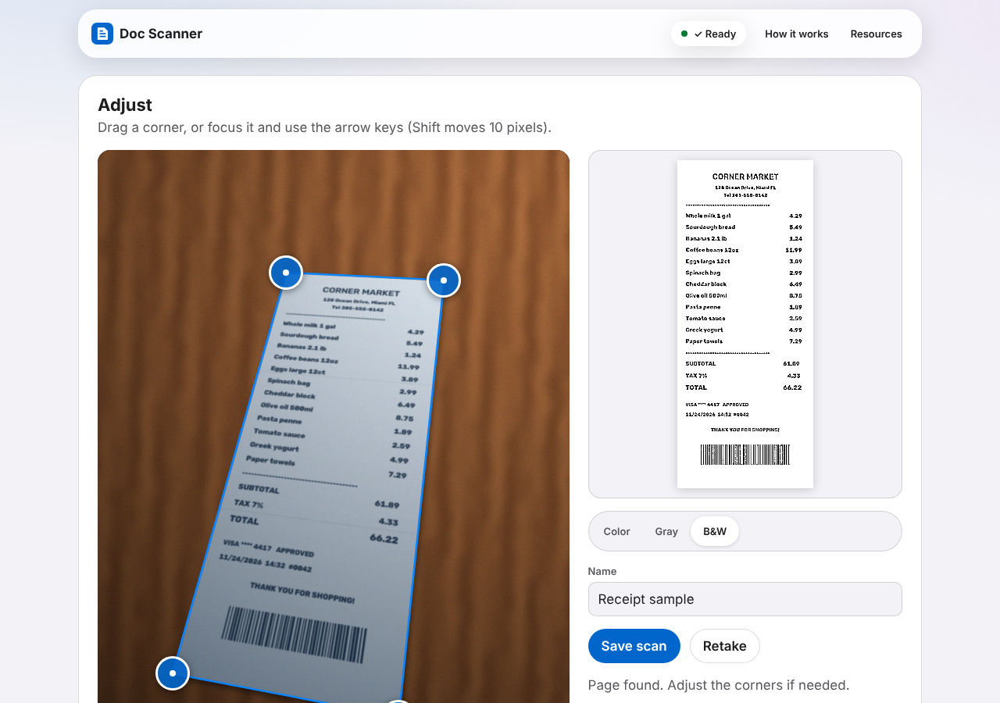
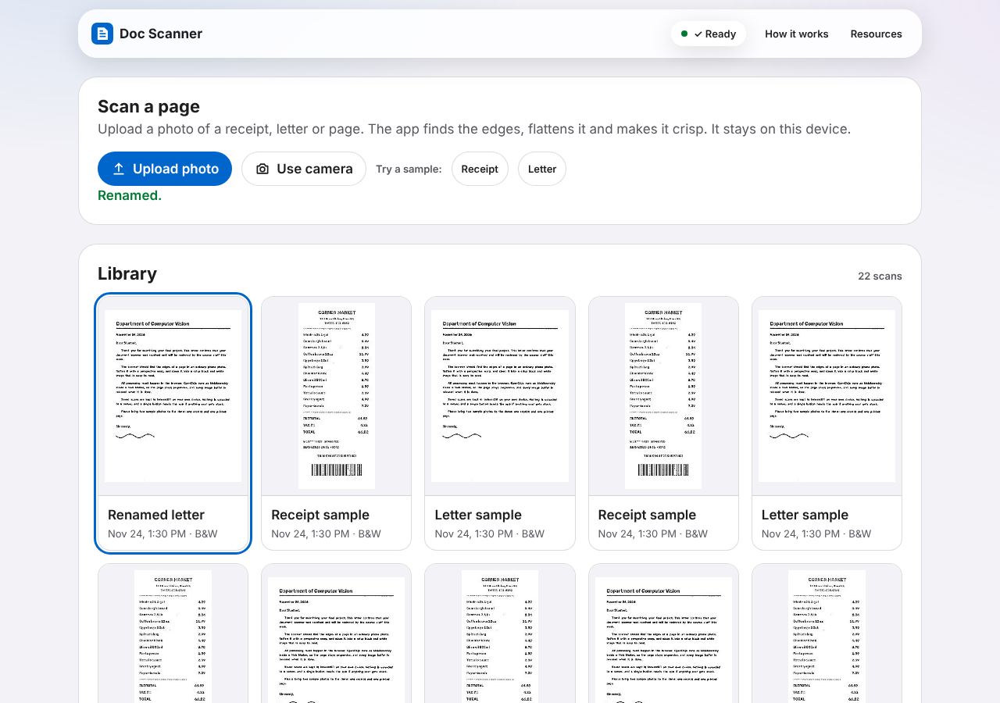
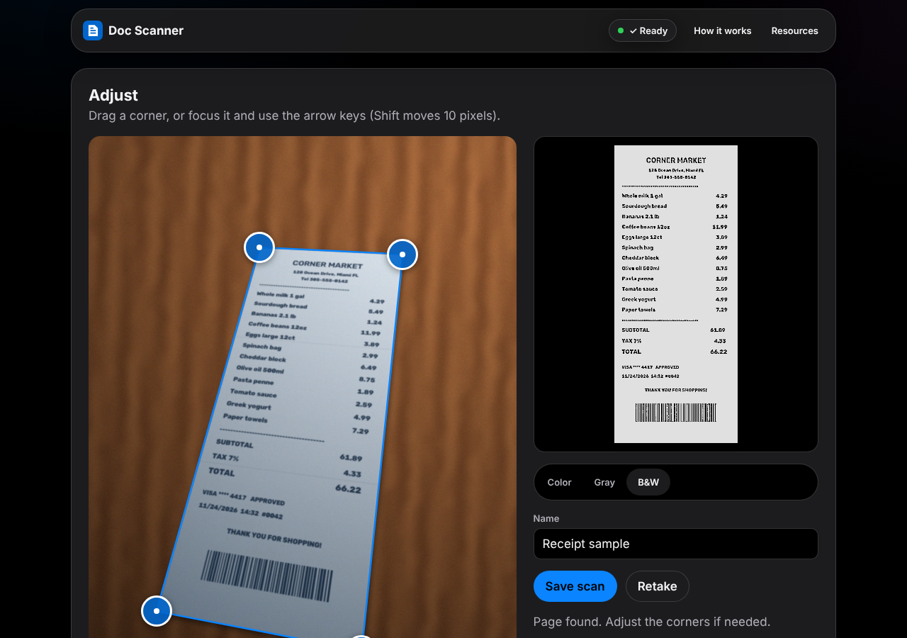
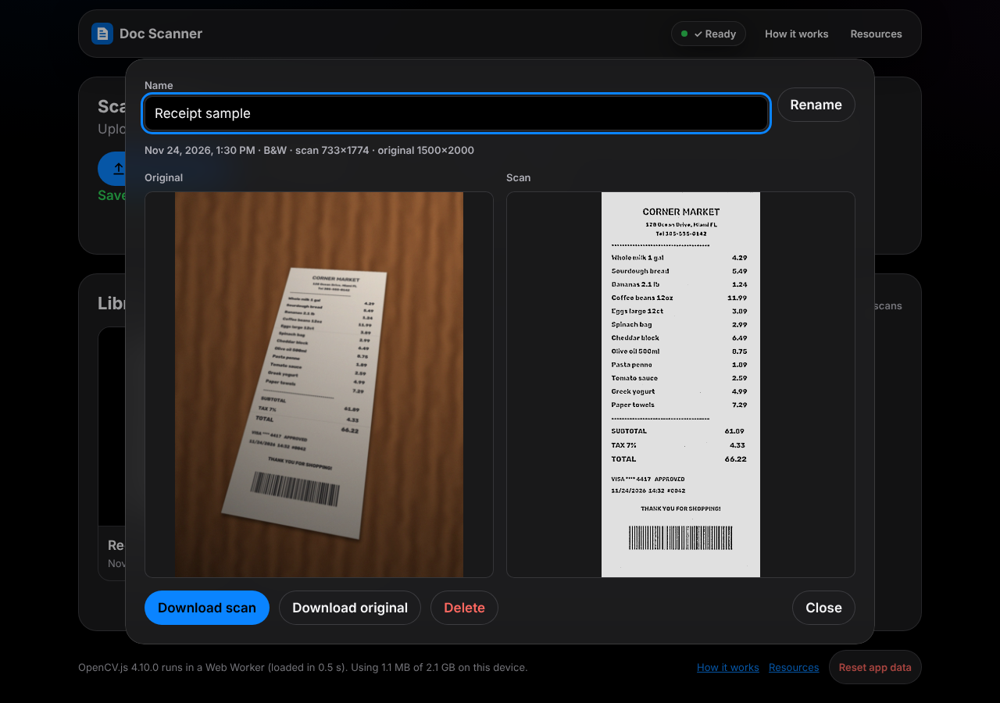

# Doc Scanner: a browser-only Smart Document Scanner

Upload or snap a photo of a receipt or page. The app finds the page edges, flattens the page with a perspective warp and cleans it into a crisp black-and-white scan, all inside your browser with **OpenCV.js** (OpenCV compiled to **WebAssembly**) running in a **Web Worker**. Every scan (the original photo and the result) is saved in **IndexedDB**, so the library survives a refresh. No server, no account, no API keys.

- **Live app:** *(add your Netlify URL here after the first deploy, see [Deploy to Netlify](#deploy-to-netlify))*
- **Source:** https://github.com/arianpousa/CVFinal
- **Assignment guide:** https://cvfinal-doc-scanner.netlify.app/guide/
- In the app: [How it works](how-it-works.html) · [Resources](resources.html)

| Adjust (light) | Library (light) |
|---|---|
|  |  |
| **Adjust (dark)** | **Original and scan side by side (dark)** |
|  |  |

## Features
- **Finds the page automatically:** grayscale → Gaussian blur → Canny edges → contours → largest 4-corner shape, with an Otsu-threshold fallback, and a full-frame fallback you can drag into place.
- **Flattens it to its true shape:** perspective warp, with the page's real width-to-height ratio estimated from the four corners, so a letter shot at an angle stays letter-shaped.
- **Crisp B&W** with adaptive thresholding (or keep Color / Gray), live preview while you drag the corners (mouse, touch or arrow keys).
- **Library that persists:** original photo + scan + thumbnail stored as Blobs with name and date; open, rename, download both, delete.
- **Never freezes, never leaks:** OpenCV.js loads once in a Web Worker; every `cv.Mat` is deleted; a stuck worker is restarted automatically.
- **Recovery built in:** clear messages for a blocked database upgrade, an outdated tab, a full disk or a scanner that didn't load, plus an always-available **Reset app data** button.
- Webcam capture, drag-and-drop, two sample photos, light and dark mode, keyboard and screen-reader support.

## How it works (short version)
- **OpenCV.js** is the C++ OpenCV library rebuilt for the web. The app self-hosts the official **4.10.0** build as `vendor/opencv-4.10.0.js` (10.4 MB, ~3.4 MB compressed, the WebAssembly is embedded in the file).
- **WebAssembly** runs that code at near-native speed. Its memory isn't garbage-collected, so the pipeline (`src/scanner-pipeline.js`) deletes every `cv.Mat` in `try/finally`.
- A **Web Worker** (`cv-worker.js`) loads OpenCV.js once and does all the vision work; the page only scales images and draws results, so it stays responsive.
- **IndexedDB** (`src/db.js`, database `docscanner` v1): stores `scans` (metadata), `blobs` (original, result, thumbnail), `settings`, `history`. One transaction per save; handles `onblocked`, `onversionchange`, `VersionError` and `QuotaExceededError`.

The full plain-language explanation is on the [How it works](how-it-works.html) page.

## Project layout
| Path | What it is |
|---|---|
| `index.html`, `app.js`, `styles.css` | the app shell, UI logic and Liquid-Glass-style design system |
| `cv-worker.js`, `src/cv-client.js` | the OpenCV Web Worker and its main-thread client (timeouts, respawn) |
| `src/scanner-pipeline.js` | the vision pipeline (detect, warp, clean) |
| `src/db.js`, `src/capture.js` | IndexedDB layer; upload/camera/canvas helpers |
| `vendor/opencv-4.10.0.js` | pinned, self-hosted OpenCV.js |
| `samples/` | two sample photos (+ `truth.json` with their true page corners) |
| `how-it-works.html`, `resources.html` | explainer and every link the project relies on |
| `netlify.toml` | static hosting config and headers |
| `tests/`, `tools/` | unit + Chrome tests; sample-photo generator (dev only, the app doesn't load them) |
| `docs/`, `knowledge/`, `.claude/` | research, design spec, hand-off log, the agent team and its knowledge base |

## Run it locally (Windows)
OpenCV.js must be served over `http://`, not opened as a file.
1. Install Python 3 from https://www.python.org/downloads/ (tick "Add python.exe to PATH").
2. Open **Command Prompt** or **PowerShell** in the repo folder and run:
   ```bat
   python -m http.server 8080
   ```
3. Open **http://localhost:8080** in Chrome. The pill turns from "Loading scanner…" to "✓ Ready".
4. Click **Receipt** or **Letter** under "Try a sample", adjust the corners if you like, then **Save scan**.
5. DevTools: **F12** (or **Ctrl+Shift+I**). Hard reload: **Ctrl+Shift+R**. Stop the server with **Ctrl+C**.

The camera works on `localhost` and on the HTTPS Netlify site (browsers block it on plain `http://` addresses other than localhost).

## Deploy to Netlify
No build step, no environment variables, no functions. `netlify.toml` already sets everything.
1. Push this repo to GitHub (it lives at `arianpousa/CVFinal`, branch `main`).
2. Sign in at https://app.netlify.com → **Add new site** → **Import an existing project** → **GitHub** → authorize → pick **arianpousa/CVFinal**.
3. Settings: **Branch to deploy** `main` · **Build command** *(leave empty)* · **Publish directory** `.` · click **Deploy**.
4. When it's live, open the `https://<your-site>.netlify.app` URL in Chrome and check the pill says **Ready**. Optionally rename the site under **Site configuration → Change site name**.
5. Every push to `main` redeploys automatically.

**Verify the deploy** (from a terminal in the repo):
```bat
curl -sI https://<your-site>.netlify.app/vendor/opencv-4.10.0.js
node knowledge\netlify-deployer\examples\check-live-headers.mjs https://<your-site>.netlify.app
cd tests && npm install && node e2e\app.e2e.cjs https://<your-site>.netlify.app/
```
You should see `cache-control: public, max-age=31536000, immutable` and a JavaScript content type on the OpenCV file. To upgrade OpenCV later, add it under a **new file name** (for example `vendor/opencv-4.11.0.js`) and update `cv-worker.js`, because the old name is cached for a year.

## Troubleshooting
| Problem | Fix |
|---|---|
| Stuck on "Loading scanner…" | Hard reload (**Ctrl+Shift+R**). In DevTools → **Network**, check `opencv-4.10.0.js` loaded (200). If the banner offers **Try again**, use it. |
| "Close other tabs of this app to finish updating." | Another tab holds an older database version. Close it; this tab continues on its own. |
| "This page is out of date." | The database was upgraded by a newer version in another tab. Reload. |
| "Storage is full." | Delete some scans. DevTools → **Application → Storage** shows usage. |
| Anything else stuck, or you want a clean start | Click **Reset app data** (footer, bottom right) → **Delete all**. It stops the worker, deletes the `docscanner` database and reloads. |
| Want to look at the data | **F12** → **Application** → **IndexedDB** → **docscanner** → `scans` / `blobs` (press the refresh icon after saving). Right-click to delete entries, or **Application → Storage → Clear site data** to wipe everything. |
| Worker errors | **F12** → **Console**; the worker shows up under **Sources → Threads**. |

## Tests
Unit tests run in Node (OpenCV.js from npm, a spec-compliant fake IndexedDB). The end-to-end tests drive the real app in Chrome with Playwright and start their own `python -m http.server`.
```bat
cd tests
npm install
npx playwright install chromium
npm run test:unit
npm run test:e2e
```
To use your installed Google Chrome instead of Playwright's Chromium, set `PW_CHANNEL=chrome` first (`set PW_CHANNEL=chrome` in Command Prompt, `$env:PW_CHANNEL="chrome"` in PowerShell).

**Recorded results (2026-11-24, headless Google Chrome, OpenCV.js 4.10.0):**
| Suite | Result | Highlights |
|---|---|---|
| `unit/pipeline.test.mjs` | 21/21 | both samples: corners within 2.2 px (0.09 % of the diagonal); true page shape recovered (receipt h/w 2.420 vs 2.419, letter 1.252 vs 1.294); B&W only 0/255; clean borders; **Wasm heap 128 → 128 MiB over 420 scans** |
| `unit/cv-client.test.mjs` | 15/15 | timeouts, respawn after a hang, respawn cap, fatal load error, restart |
| `unit/db.test.mjs` | 24/24 | original + result Blobs round-trip, refresh, atomic save/delete, rollback, blocked upgrade → unblocked, VersionError, quota, Reset |
| `unit/contrast.test.mjs` | 18/18 | every text/background pair in light and dark, glass checked at its worst case |
| `e2e/app.e2e.cjs` | 39/39 | Ready in ~0.7 s locally; opencv.js fetched once; both samples scanned; longest main-thread gap 77 ms over 22 scans; heap 128 → 128 MiB; 22 scans survive reload; blocked upgrade, outdated tab, stale tab, Reset; 12 MP photo; camera + denied camera; pages linked; no console errors |
| `e2e/a11y.e2e.cjs` | 22/22 | full keyboard flow, corner arrow keys (1 px / 10 px), live regions, 44 px targets, 200 % zoom, Reduce Motion |

Also passing: `validate_config.py` (netlify.toml, 7/7), `check-resources.mjs` (resources.html, 11/11), `audit_team.py` (11 agents, 14 skills).

**Sample photos:** `samples/receipt.jpg` and `samples/letter.jpg` are rendered by `tools/make_samples.py` (a pinhole-camera projection of a printed page onto a desk, with uneven light, shadow, blur, noise and JPEG compression), because the build machine had no internet access to fetch real photos. Run `python tools/make_samples.py` to regenerate them. Try your own phone photos too.

## Team: who did what
Built for an 11-agent Claude Code team (`.claude/agents/`, design in `docs/expert-roster.md`, names and models in `docs/agent-brains.md`), run by the orchestrator **Morgan**. Every hand-off and review is in [`docs/handoff-log.md`](docs/handoff-log.md).

**Honest note on how this build ran:** the orchestrator session had no tool to spawn subagents, so Morgan carried out each expert's task in turn, in that expert's role, using that expert's knowledge folder and tested examples, and reviewed each result with the named reviewer's checklist. The plan's parallel waves (`docs/build-plan.json`: 11 tasks, 7 waves, up to 4 tasks per wave) show what can run in parallel when the team is launched with subagents; in this run they executed one after another.

| Role (agent) | Delivered | Reviewed by: outcome |
|---|---|---|
| **Morgan** (orchestrator) | plan + waves, routing, final gates, this section | Paige: approved |
| **Iris** (opencv-expert) | `src/scanner-pipeline.js` (Canny + Otsu fallback, aspect-ratio-correct warp, adaptive threshold), `tools/make_samples.py`, `samples/`, pipeline tests | Theo: approved (no heap growth); later fixed the B&W edge ticks Sable reported |
| **Theo** (wasm-expert) | `cv-worker.js`, `src/cv-client.js`, `vendor/opencv-4.10.0.js`, client tests | Iris: **changes requested** (lost `ready` message if the runtime fired during `importScripts`) → fixed → approved |
| **Archie** (indexeddb-expert) | `src/db.js` (original + result Blobs, upgrades, blocked/outdated handling, Reset), DB tests | Quinn: approved (24/24) |
| **Wren** (ux-designer-apple-hig) | `docs/design/flow-spec.md`: flow, states, copy, a11y criteria; keyboard test | Sable: approved |
| **Sable** (ui-designer-apple-liquid-glass) | `styles.css` design system, light/dark | Wren: approved |
| **Leo** (frontend-engineer) | `index.html`, `app.js`, `src/capture.js`: capture, camera, corner editor, preview, library, viewer, Reset | Sable: **changes requested** (cropped thumbnails, edge ticks, sticky-bar overlap, wrapping dates); Wren: **changes requested** ("No scans yet" shown during a blocked upgrade); Quinn: bug (full-frame fallback off by a fraction) → all fixed → approved |
| **Paige** (docs-writer) | `how-it-works.html`, `resources.html`, this README | check-resources failed once (duplicate links) → fixed; Wren and Piper: approved |
| **Piper** (netlify-deployer) | `netlify.toml` | Theo: approved (7/7) |
| **Quinn** (qa-tester) | `tests/e2e/` (39 + 22 checks), contrast test, screenshots, sign-off | Morgan: approved |
| **Mira** (meta-agent) | the team files themselves (earlier commits); `audit_team.py` passes | — |

**Hand-off chain:** Morgan → wave 1 {Iris: pipeline + samples · Theo: worker · Archie: storage · Wren: flow} → reviews (Theo ⇄ Iris, Quinn → Archie, Sable → Wren) → wave 2 {Piper: netlify.toml (Theo reviews) · Sable: styles (Wren reviews)} → wave 3 Leo: app shell, using Iris's, Theo's, Archie's, Wren's and Sable's outputs (Sable + Wren review, a fix routed back to Iris) → wave 4 Paige: pages (Wren reviews) → wave 5 Quinn: QA (bug routed back to Leo) → wave 6 Paige: README (Piper reviews) → wave 7 Morgan: summary (Paige reviews). Five review rounds requested changes; all were fixed and re-tested.

## Resources
Every official doc, the repo and the guide are listed on the [Resources](resources.html) page.
